# Governance guardrails on Azure

## Watch the walkthrough

[Watch the video](https://www.loom.com/share/6f35ccb43dbb4a57b4905d501d9b9163)

**Author:** Zeon Stewart, [LinkedIn](LINKEDIN_LINK_HERE)

## At a glance

- **What it is:** one resource group with three guardrails. A test user can only read it. Policy denies any virtual machine size that is not on a two-name allow list. A budget sends email as spend nears 50 US dollars.
- **What's automated:** Terraform creates the group, the user, the role, the policy, and the budget. `./scripts/verify.sh` checks them. `./scripts/teardown.sh` removes them after the resource group name is typed.
- **Why it's secure:** the test user is Reader on this group only. The password and the alert address are not in the repository. No virtual machine is created.
- **Result:** all nine checks passed while the group was up. `Standard_F16als_v7` was denied. `terraform destroy` then removed five resources. The group is gone.

Part of [Cloud Projects](https://github.com/zsociety47/cloud-projects). Technical details are in [Technical findings](#technical-findings) at the bottom.

---

## Project Steps

These steps follow the files in the order each one needs the one before it. Have Terraform 1.15 and the Azure command-line interface (CLI) installed, and sign in with `az login` before the first plan.

Set the subscription for the terminal session without writing it into a file:

```bash
export ARM_SUBSCRIPTION_ID="$(az account show --query id -o tsv)"
```

`ARM` is the prefix the Azure Resource Manager provider uses for its environment variables. Read each plan before you type `yes`.

The test user's password and the budget alert address have no default. Put them in a file named `.env` in this folder. That file is gitignored.

```bash
TF_VAR_user_password='your-password'
TF_VAR_budget_alert_email='your-address'
```

The password has to meet Microsoft Entra ID's rules: at least 8 characters, with uppercase, lowercase, a number, and a symbol. Do not commit `.env`.

### Step 1: Keep the state file off GitHub

*Declared in `.gitignore`, before `terraform init` or `terraform apply`.*

`terraform init` downloads the providers into `.terraform/`. `terraform apply` writes `terraform.tfstate`. The state file holds the test user's password and resource identifiers. Both the state file and `.terraform/` are ignored. `.terraform.lock.hcl` is not ignored.

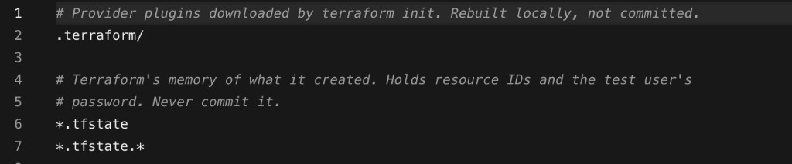

### Step 2: Pin the providers

*Declared in `versions.tf`. Read by `terraform init`.*

The Terraform block requires version 1.15.x, the AzureRM provider `5.10.0`, and the `azuread` provider `3.10.0`. AzureRM manages the group, the role, the policy, and the budget. `azuread` manages the user in Microsoft Entra ID.

```bash
terraform init
```

The last line should be `Terraform has been successfully initialized!`

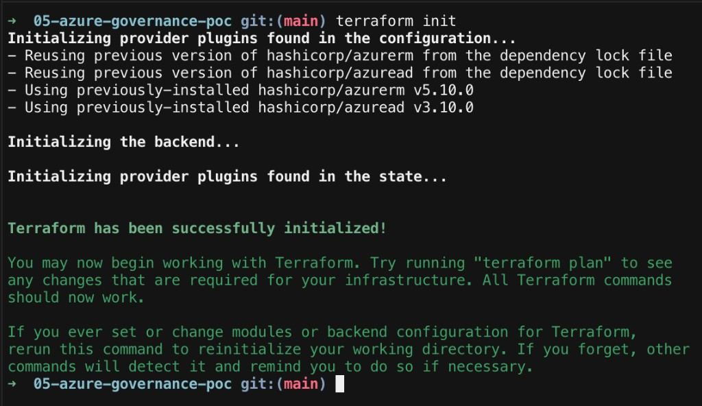

### Step 3: Sign in without storing the subscription id

*Declared in `provider.tf`. Used by every later file.*

The providers use the Azure CLI login already on the machine. There is no `subscription_id` line in the file. `resource_provider_registrations = "none"` means apply does not register Azure resource providers. `Microsoft.Authorization` and `Microsoft.Consumption` are already registered.

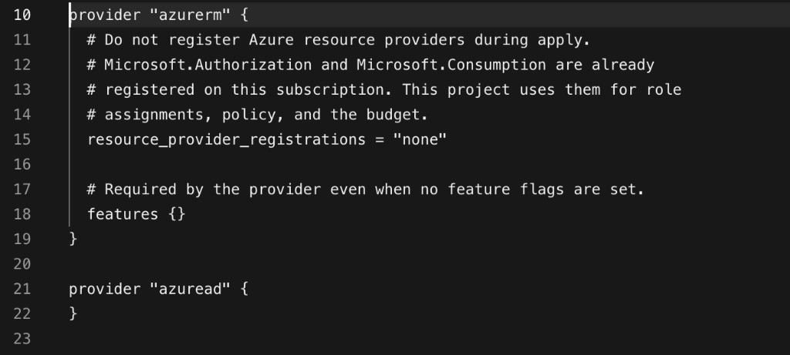

### Step 4: Put the names in one place

*Declared in `variables.tf`. Read by every resource file.*

| Name | Value |
|---|---|
| Resource group | `rg-gov-poc-zeon01` |
| Region | East US |
| Test user | Junior Developer, mail nickname `junior-dev-zeon` |
| Role | Reader |
| Policy assignment | `restrict-vm-sizes` |
| Allowed virtual machine sizes | `Standard_F1als_v7`, `Standard_F1as_v7` |
| Size the check tries to block | `Standard_F16als_v7` |
| Budget | `monthly-gov-budget`, 50 US dollars |
| Alerts | 80 percent of actual spend, 100 percent of the forecast |

The password and the alert address are not in this table. They come from `.env`.

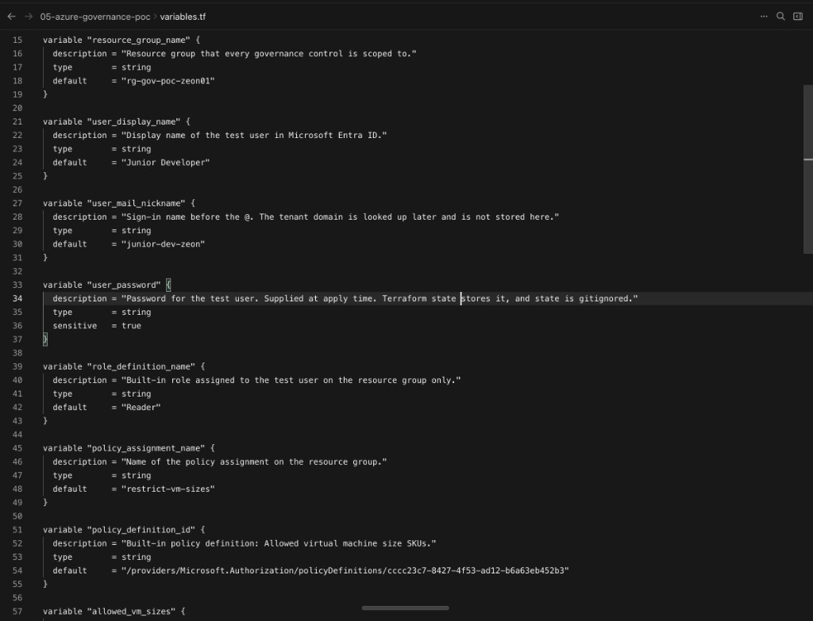

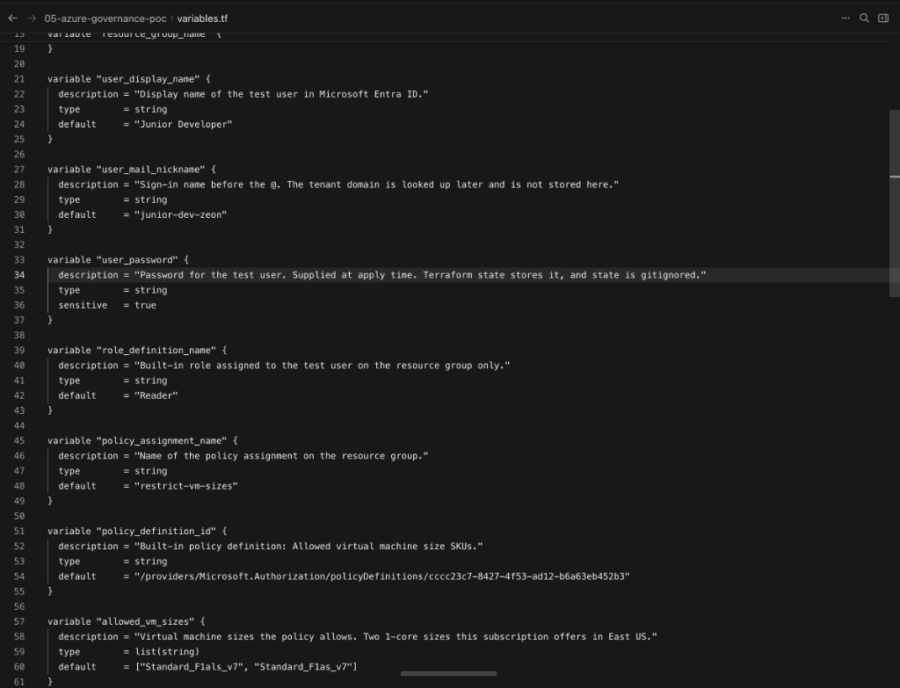

### Step 5: Create the resource group

*Declared in `resource_group.tf`. Created by `terraform apply`.*

Every control in this build is scoped to `rg-gov-poc-zeon01`. The first plan, before the later files exist, is `1 to add, 0 to change, 0 to destroy`. Later files reference `azurerm_resource_group.rg`, so the group is declared first.

### Step 6: Look up the default domain

*Declared in `domain.tf`. Read by the user file. It creates nothing.*

The sign-in name is `junior-dev-zeon` plus the tenant's default domain. The domain is not written in the repository. `only_default = true` keeps the list to one domain, and the check fails the plan if that list is not exactly one entry. With only this file added, the plan is no changes.

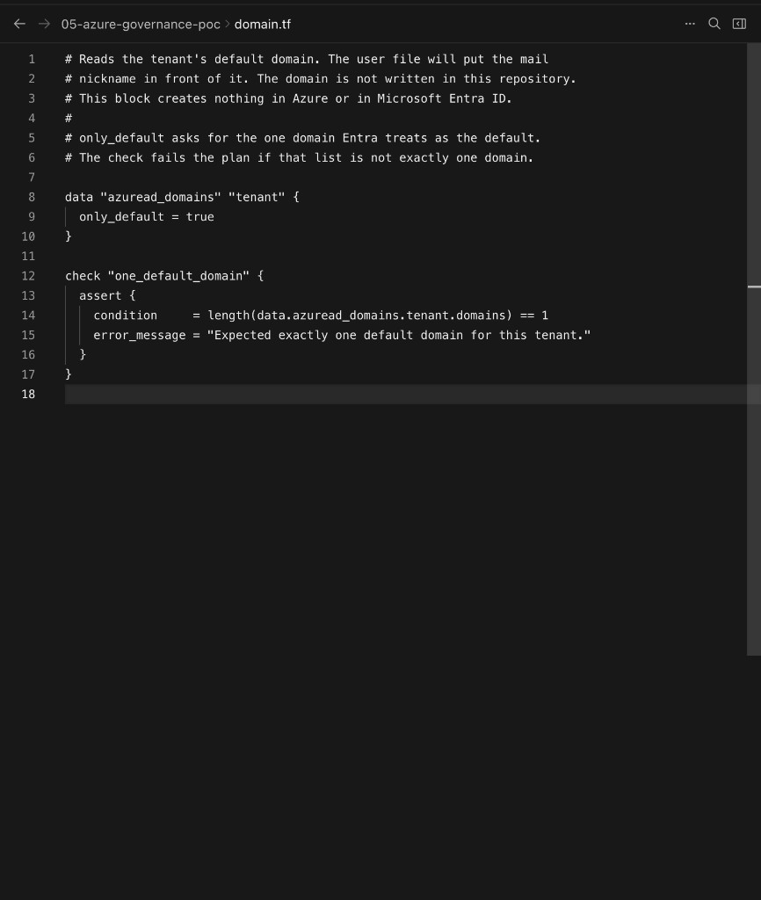

### Step 7: Create the test user

*Declared in `user.tf`. Created by `terraform apply`.*

`user_principal_name` joins the mail nickname to the domain from step 6. `account_enabled` is true. `show_in_address_list` is false, so the test account is not listed as a person. The plan is `1 to add`. The password line is sensitive. Do not paste the sign-in name into notes. It contains the tenant domain.

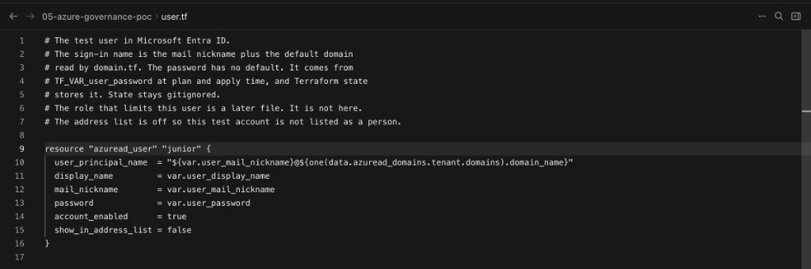

### Step 8: Grant Reader on this group only

*Declared in `reader_role.tf`. Created by `terraform apply`.*

`scope` is `rg-gov-poc-zeon01`. `principal_id` is the user's object id. Reader can look at resources in this group. It cannot create, change, or delete them. The plan is `1 to add`. The role does not extend to the subscription.

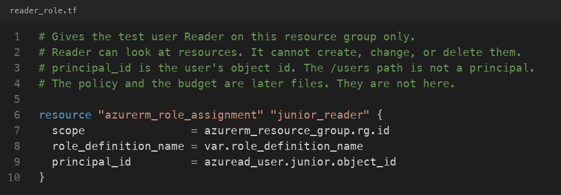

### Step 9: Deny every other virtual machine size

*Declared in `vm_size_policy.tf`. Created by `terraform apply`.*

The built-in policy is "Allowed virtual machine size SKUs." Its effect is Deny. `enforce = true` means Azure applies that deny. The allow list is `Standard_F1als_v7` and `Standard_F1as_v7`. The plan is `1 to add`. No virtual machine is created.

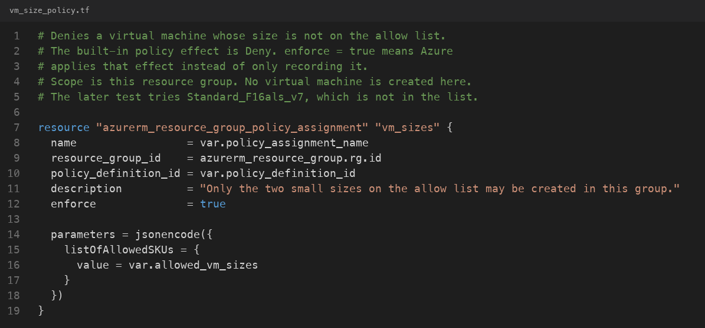

### Step 10: Alert before the month's limit

*Declared in `budget.tf`. Created by `terraform apply`.*

`monthly-gov-budget` is 50 US dollars per month, starting on the first day of October 2026. Azure requires that start date to be the first day of a month. One alert fires when actual spend reaches 80 percent. The other fires when the forecast reaches 100 percent. Both go to the address in `.env`. The plan hides those blocks because the address is sensitive. The plan is `1 to add`. A budget sends email. It does not stop spending.

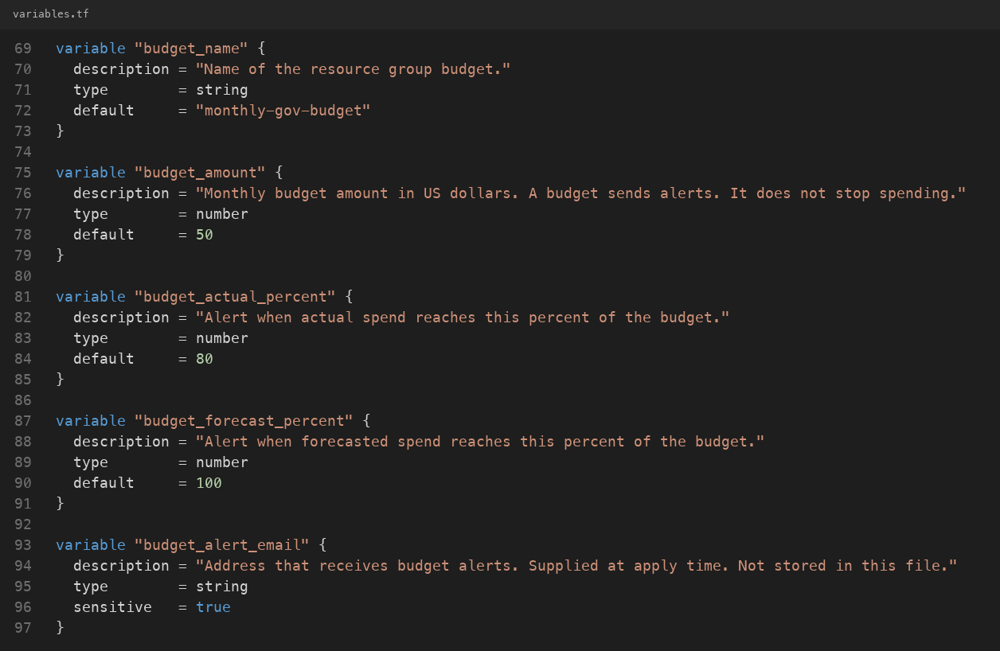

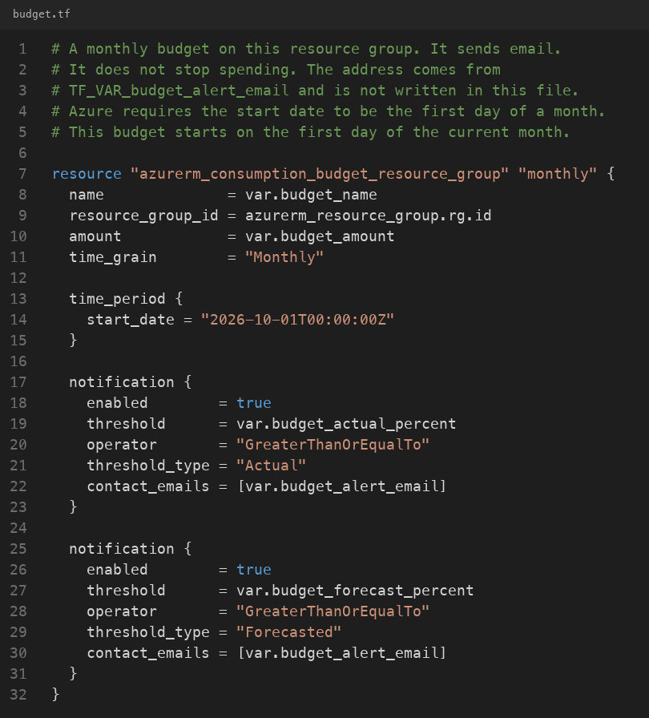

### Step 11: Check the live controls

*Read each guardrail from Azure, then run `./scripts/verify.sh`.*

The commands below ask Azure the same questions the script asks. They do not create a virtual machine. Crop each result to the table or the JSON. Do not include a line that contains `/subscriptions/`. Do not drop the `--query` flags. Without them, the sign-in name or the alert address can print.

The test user is enabled, and the mail nickname is `junior-dev-zeon`. This query does not ask for the sign-in name.

```bash
az rest --method get \
  --url "https://graph.microsoft.com/v1.0/users?\$filter=displayName eq 'Junior Developer'&\$select=displayName,accountEnabled,mailNickname" \
  --query "value[].{name:displayName, enabled:accountEnabled, nickname:mailNickname}" \
  -o table
```

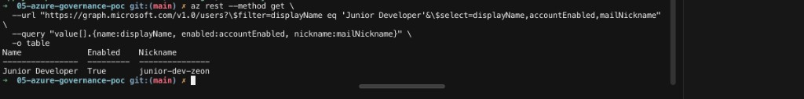

The only role on `rg-gov-poc-zeon01` is Reader, and it is a user. Reader can look. It cannot create, change, or delete.

```bash
az role assignment list \
  --resource-group rg-gov-poc-zeon01 \
  --query "[].{role:roleDefinitionName, kind:principalType}" \
  -o table
```

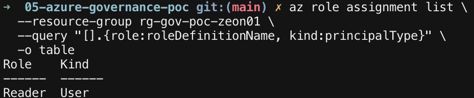

The policy assignment is `restrict-vm-sizes`. `Default` means the deny is turned on. The allow list is the two small sizes.

```bash
az policy assignment list \
  --resource-group rg-gov-poc-zeon01 \
  --query "[].{name:name, enforcement:enforcementMode, sizes:parameters.listOfAllowedSKUs.value}" \
  -o json
```

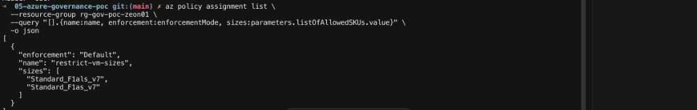

The budget is 50 US dollars a month. One alert is at 80 percent of actual spend. The other is at 100 percent of the forecast. The address is not in this result.

```bash
az rest --method get \
  --url "$(az group show --name rg-gov-poc-zeon01 --query id -o tsv)/providers/Microsoft.Consumption/budgets/monthly-gov-budget?api-version=2023-05-01" \
  --query "{amount:properties.amount, monthly:properties.timeGrain, alerts:properties.notifications.*.{at:threshold, when:thresholdType}}" \
  -o json
```

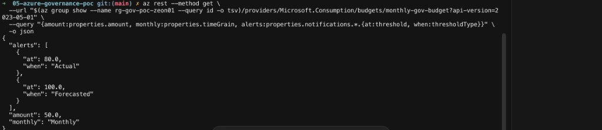

Ask what policy would do with a sixteen-core size. The result is one row: `restrict-vm-sizes`, `NonCompliant`, `Deny`. No virtual machine is created.

```bash
az rest --method post \
  --url "$(az group show --name rg-gov-poc-zeon01 --query id -o tsv)/providers/Microsoft.PolicyInsights/checkPolicyRestrictions?api-version=2024-10-01" \
  --body '{"resourceDetails":{"apiVersion":"2024-07-01","resourceContent":{"type":"Microsoft.Compute/virtualMachines","location":"eastus","properties":{"hardwareProfile":{"vmSize":"Standard_F16als_v7"}}}}}' \
  --query "contentEvaluationResult.policyEvaluations[?policyInfo.policyAssignmentName=='restrict-vm-sizes'].{assignment:policyInfo.policyAssignmentName, result:evaluationResult, effect:effectDetails.policyEffect}" \
  -o table
```

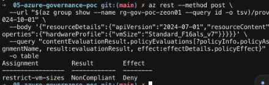

Ask again with `Standard_F1als_v7`. That command prints no rows, because the small size is not denied. Then count virtual machines in the group. The count is `0`.

```bash
az rest --method post \
  --url "$(az group show --name rg-gov-poc-zeon01 --query id -o tsv)/providers/Microsoft.PolicyInsights/checkPolicyRestrictions?api-version=2024-10-01" \
  --body '{"resourceDetails":{"apiVersion":"2024-07-01","resourceContent":{"type":"Microsoft.Compute/virtualMachines","location":"eastus","properties":{"hardwareProfile":{"vmSize":"Standard_F1als_v7"}}}}}' \
  --query "contentEvaluationResult.policyEvaluations[?policyInfo.policyAssignmentName=='restrict-vm-sizes'].{assignment:policyInfo.policyAssignmentName, result:evaluationResult, effect:effectDetails.policyEffect}" \
  -o table
```

```bash
az vm list --resource-group rg-gov-poc-zeon01 --query "length(@)" -o tsv
```

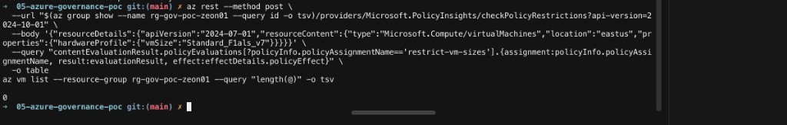

The script checks those same facts and prints nine lines.

```bash
./scripts/verify.sh
```

A passing run looks like this:

```text
1  Resource group rg-gov-poc-zeon01 is in eastus: PASS
2  Test user Junior Developer is enabled: PASS
3  Reader on rg-gov-poc-zeon01 is only the test user: PASS
4  Policy restrict-vm-sizes allows only the two small sizes: PASS
5  Budget monthly-gov-budget is 50 dollars with both alerts: PASS
6  Size Standard_F16als_v7 is denied by restrict-vm-sizes: PASS
7  Size Standard_F1als_v7 is not denied: PASS
8  Resource group rg-gov-poc-zeon01 has no virtual machine: PASS
9  terraform plan reports no changes: PASS
```

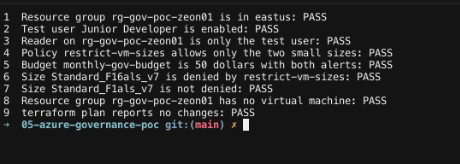

### Step 12: Remove it

*Run `./scripts/teardown.sh`, after you type the resource group name and then `yes`.*

The script prints what it will delete and stops unless the typed name is `rg-gov-poc-zeon01`. `terraform destroy` then shows its plan and waits for `yes`. Destroy removes the budget, the Reader role, the Entra user, the size policy, and the resource group. The user is not inside the group. Terraform removes the user because the user is in the state file.

```bash
./scripts/teardown.sh
```

The destroy plan should be `0 to add, 0 to change, 5 to destroy`. When it finishes, `rg-gov-poc-zeon01` is gone. Run `./scripts/verify.sh` once more and all nine lines print `FAIL`. That is the expected result. There is nothing left for the checks to find, and the next plan wants to add the five resources again.

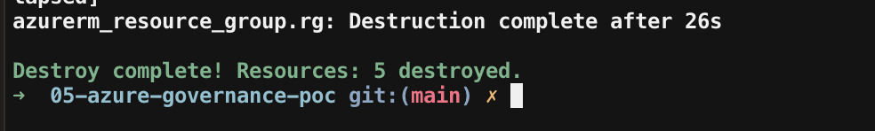

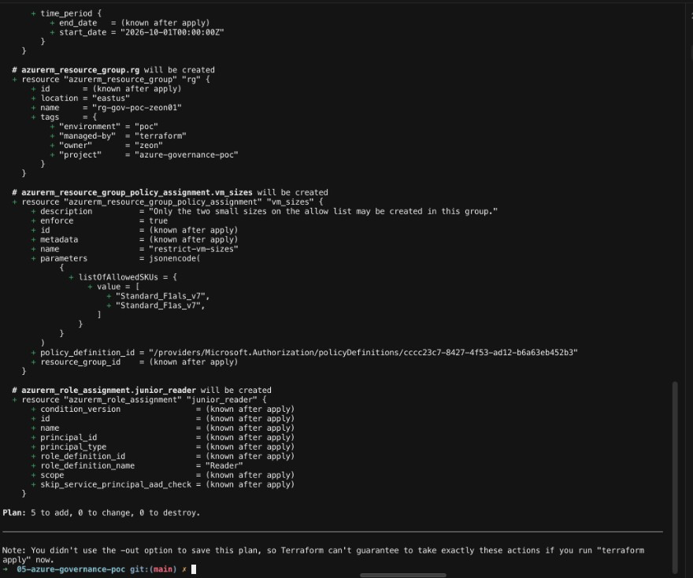

---

## Automated setup

### Run this as yourself

The names in `variables.tf` are this proof of concept. Copy `terraform.tfvars.example` to `terraform.tfvars` (gitignored). Change `resource_group_name`, `user_mail_nickname`, and `tags.owner`. The mail nickname must be unique in your tenant. Put your owner word in it. Keep supplying the password and the alert address from `.env`, not from a committed file.

You need Terraform 1.15.x, the Azure command-line interface (CLI), and a current `az login`. Run these from the repository root, in this order. Each group is one action. Read what you should see before you start the next group.

If Microsoft Entra ID asks for multi-factor authentication, approve it in the browser. Do not add `--use-device-code` to `az login`. That flow is often blocked when the computer is not registered with Entra ID.

### Sign in for this terminal

The subscription stays in this terminal session. The password and the alert address come from `.env`, which is gitignored. Nothing here is written into a file.

```bash
export ARM_SUBSCRIPTION_ID="$(az account show --query id -o tsv)"
set -a
source .env
set +a
```

You should see no output. Do not print either value.

### Download the providers

This is step 2. It runs once per machine.

```bash
terraform init
```

The last line should be `Terraform has been successfully initialized!`

### Read the plan

Every file is already in the folder, so this one plan covers steps 5 through 10. The domain lookup creates nothing.

```bash
terraform plan
```

You should see `5 to add, 0 to change, 0 to destroy`: the resource group, the test user, the Reader role, the size policy, and the budget. Read the plan before you type `yes`. A line that contains `/subscriptions/` is not a screenshot.

### Create the five controls

```bash
terraform apply
```

Type `yes` only if the plan still says `5 to add`. The size policy takes about two minutes.

### Read each guardrail

These are the commands in step 11, in the same order. Run one, read the result, then run the next. None of them creates a virtual machine.

| Command in step 11 | What you are checking | A pass looks like |
|---|---|---|
| The user query | The test account is on and usable | `Junior Developer`, enabled, nickname `junior-dev-zeon` |
| The role query | Who can touch this group | One row: `Reader`, `User` |
| The policy query | Which sizes are allowed | `restrict-vm-sizes`, enforcement `Default`, the two small sizes |
| The budget query | What the month is allowed to cost | Amount `50`, monthly, alerts at `80` Actual and `100` Forecasted. No address |
| The large-size query | The rule blocks an oversized machine | One row: `restrict-vm-sizes`, `NonCompliant`, `Deny` |
| The small-size query, then the machine count | The allowed size is accepted, and no machine exists | No deny row, then `0` |

### Confirm with the script

The script checks those same facts and prints one line each.

```bash
./scripts/verify.sh
```

You should see nine `PASS` lines.

### Remove it

This is step 12. The script stops unless the typed name is `rg-gov-poc-zeon01`. Terraform then asks for `yes` on its own.

```bash
./scripts/teardown.sh
```

The destroy plan should be `0 to add, 0 to change, 5 to destroy`. When it finishes, the last line is `Destroy complete! Resources: 5 destroyed.` The next plan is `5 to add` again. Leave any `/subscriptions/` line out of a screenshot.

### Prove it in the portal

| Check | Where to click | A pass looks like |
|---|---|---|
| 1. The resource group exists in East US | **Resource groups**, `rg-gov-poc-zeon01` | Region East US. Tags include `managed-by = terraform` |
| 2. The test user is enabled | **Microsoft Entra ID**, **Users**, Junior Developer | Account enabled. Crop the sign-in name |
| 3. Reader is only that user | `rg-gov-poc-zeon01`, **Access control**, **Role assignments** | One Reader row for Junior Developer |
| 4. The size policy is enforced | `rg-gov-poc-zeon01`, **Policies** | `restrict-vm-sizes`, allowed sizes `Standard_F1als_v7` and `Standard_F1as_v7` |
| 5. The budget has both alerts | `rg-gov-poc-zeon01`, **Budgets** | `monthly-gov-budget`, amount 50. Crop the alert address |
| 6. The large size would be denied | `./scripts/verify.sh` check 6 | PASS for `Standard_F16als_v7` |
| 7. The small size is not denied | `./scripts/verify.sh` check 7 | PASS for `Standard_F1als_v7` |
| 8. No virtual machine exists | `rg-gov-poc-zeon01` | No virtual machine in the group |
| 9. Teardown removed the group | **Resource groups** | `rg-gov-poc-zeon01` is not in the list |

---

## Architecture

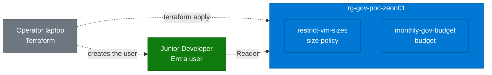

**How to read this diagram**

- **Solid arrow:** Junior Developer can read `rg-gov-poc-zeon01`. That is the only access the user is granted.
- **Dashed arrow:** Terraform, from the laptop, creates the group and the user.
- **Blue:** the resource group, the size policy, and the budget. **Green:** the test user. **Gray:** the laptop running Terraform.
- The policy denies any other virtual machine size inside the group. The budget sends email. Neither one creates a virtual machine.

*The text files are the source of truth. Terraform changes only the piece that differs from the state file.*

*Diagram follows the [shared diagram standard](https://github.com/zsociety47/cloud-projects/blob/main/standards/DIAGRAM-STANDARD.md).*

---

## Hypothesis

A test user can be limited to reading one resource group, policy can deny an oversized virtual machine before it exists, and a budget can email as spend nears a monthly limit, without creating a virtual machine.

## Success criteria

| # | Criterion | How it is checked | Result |
|---|-----------|-------------------|--------|
| 1 | `rg-gov-poc-zeon01` exists in East US | `./scripts/verify.sh` check 1 | ✅ [verify output](#step-11-check-the-live-controls) |
| 2 | Junior Developer is enabled | `./scripts/verify.sh` check 2 | ✅ [verify output](#step-11-check-the-live-controls) |
| 3 | Reader on that group is only the test user | `./scripts/verify.sh` check 3 | ✅ [verify output](#step-11-check-the-live-controls) |
| 4 | `restrict-vm-sizes` allows only the two small sizes | `./scripts/verify.sh` check 4 | ✅ [verify output](#step-11-check-the-live-controls) |
| 5 | `monthly-gov-budget` is 50 dollars with both alerts | `./scripts/verify.sh` check 5 | ✅ [verify output](#step-11-check-the-live-controls) |
| 6 | `Standard_F16als_v7` is denied | `./scripts/verify.sh` check 6 | ✅ [verify output](#step-11-check-the-live-controls) |
| 7 | `Standard_F1als_v7` is not denied | `./scripts/verify.sh` check 7 | ✅ [verify output](#step-11-check-the-live-controls) |
| 8 | The group has no virtual machine | `./scripts/verify.sh` check 8 | ✅ [verify output](#step-11-check-the-live-controls) |
| 9 | After apply, `terraform plan` reports no changes | `./scripts/verify.sh` check 9 | ✅ [verify output](#step-11-check-the-live-controls) |
| 10 | Teardown removes the resource group and the user | `az group exists --name rg-gov-poc-zeon01` is false, and Entra lists no Junior Developer | ✅ [destroy step](#step-12-remove-it) |

Checks 1 through 9 were recorded while the group existed. After teardown, the same script prints FAIL on all nine lines.

## What's in this repository

```
.
├── versions.tf              Terraform 1.15, AzureRM 5.10.0, azuread 3.10.0
├── provider.tf              Azure CLI sign-in. No subscription id in the file
├── variables.tf             Names, sizes, budget amounts, and tags
├── resource_group.tf        rg-gov-poc-zeon01
├── domain.tf                Reads the tenant default domain. Creates nothing
├── user.tf                  Junior Developer
├── reader_role.tf           Reader on this group only
├── vm_size_policy.tf        restrict-vm-sizes
├── budget.tf                monthly-gov-budget
├── scripts/
│   ├── verify.sh            Nine pass/fail checks. Creates nothing
│   └── teardown.sh          Deletes after the resource group name is typed
├── .terraform.lock.hcl      Exact provider builds selected by terraform init
└── docs/
    └── architecture/        Notes for the diagram
```

## Security choices

- **The state file stays on the machine.** `terraform.tfstate` holds the test user's password and resource identifiers, including the subscription id. `.gitignore` excludes it.
- **The password and the alert address are environment variables.** `variables.tf` has no default for either one. `.env` is gitignored.
- **The subscription id is an environment variable.** `provider.tf` does not contain it.
- **Reader is scoped to one group.** The test user cannot create, change, or delete resources there, and the role does not extend to the subscription.
- **The size policy denies anything off the allow list.** The effect of the built-in definition is Deny, and `enforce = true` applies it. No virtual machine is created to prove that.
- **The budget does not stop spending.** It sends email at 80 percent of actual spend and at 100 percent of the forecast.
- **The test user is not in the address list.** `show_in_address_list` is false.
- **The tenant domain is looked up, not stored.** The sign-in name is built at apply time.

## Cost

A resource group, a role assignment, a policy assignment, a budget, and an Entra user have no hourly charge. This build has no virtual machine and no public Internet Protocol address. Delete the group when you are done so the state file and the subscription stay in agreement. Prices were checked in October 2026.

## Going further

- Sign in as Junior Developer and show that creating a resource in the group is denied by Reader, not only by policy.
- Add a second alert contact only if a second mailbox should receive the budget mail.
- Store `terraform.tfstate` in a remote backend so the password is not only on one laptop. The backend still has to keep that password out of Git.

---

## Technical findings

*For engineers: what actually happened while building this, including the errors.*

- **`East US` is stored as `eastus`.** `variables.tf` sets `location = "East US"`. The plan shows `location = "eastus"`. Those are the same region.
- **The sizes this subscription offers are not the sizes `az vm list-sizes` prints.** The first allow list was `Standard_B1s` and `Standard_B1ms`, with `Standard_D2s_v3` as the blocked size. `az vm list-skus` for this subscription does not offer those. The allow list is `Standard_F1als_v7` and `Standard_F1as_v7`. The blocked size in the check is `Standard_F16als_v7`.
- **The user id and the object id are different shapes.** `azuread_user.junior.id` is a path that starts with `/users/`. Role assignment needs `object_id`, which is the identifier alone.
- **A plan of the user prints the sign-in name.** That name contains the tenant domain, so it is not copied into this README. The password line is marked sensitive.
- **Policy assignment took about two minutes.** `restrict-vm-sizes` reported creation complete after 1 minute 52 seconds. The definition is the built-in "Allowed virtual machine size SKUs" policy. Its effect is Deny. The only parameter is `listOfAllowedSKUs`.
- **The budget plan hides the alerts.** `contact_emails` is sensitive, so Terraform does not print the notification blocks. The file still sets 80 percent Actual and 100 percent Forecasted. Azure accepted both. The address is not in this README.
- **The size check does not create a virtual machine.** `./scripts/verify.sh` posts the size to the policy restriction API. A deny for `restrict-vm-sizes` is a pass for `Standard_F16als_v7`. No deny is a pass for `Standard_F1als_v7`. After both calls, the group still had no virtual machine.
- **Destroy removed five resources.** The budget, the Reader role, the Entra user, the size policy, and then the resource group. `az group exists --name rg-gov-poc-zeon01` printed `false`. A second `./scripts/verify.sh` printed FAIL on all nine lines, and `terraform plan` was `5 to add`.
- **A plan prints full resource identifiers.** Role and policy plans include the subscription id. Those strings are not pasted into this README.
